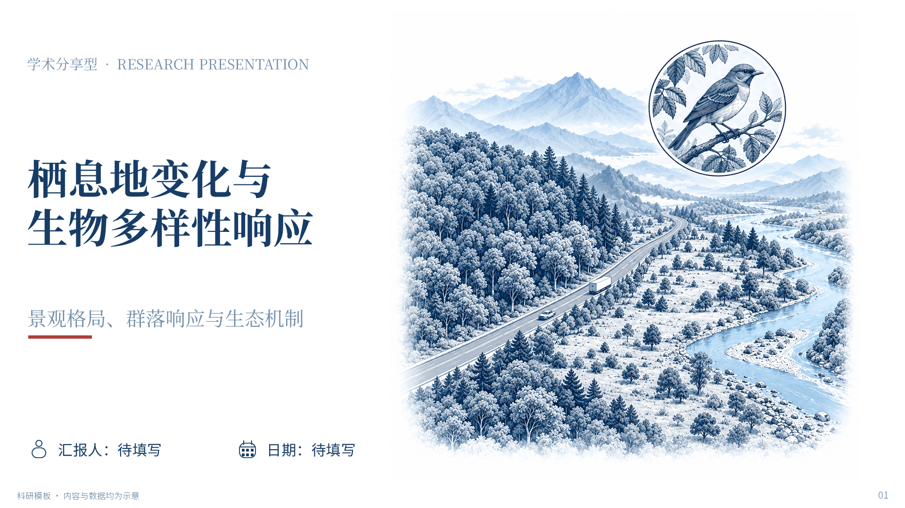

# 可编辑科研 PPT · 便携开源版 v1.7.1

三种汇报场景、十套配色、两种填充风格、二十三类版式及多种变体。支持**根据使用者提供的资料实时自适应（`visual_mode: adaptive`）**：自动移除生硬默认位图与卡片内冗余大图标，实时匹配极简学科线框图标或嵌入原图，原生表格自适应列宽与统一字号，并配备强制性的字体、字号与位置对齐核验。



**代码与文档采用 MIT；随包字体遵循 OFL-1.1；Lucide 图标遵循 ISC，完整许可与其他上游声明保留。**

## v1.7.1 通用发布与防漂移

移除本机项目标识、个人使用经历和Office作者/最后修改者信息；保留原有设计标准与合法素材署名。三种场景、十配色、两种填充、23类版式及两套字号写入冻结设计契约，维护和CI同时检查，不能以重算完整性哈希代替设计验收。

[硬性要求与检查边界](references/publication-policy.md) · [设计契约](references/design-contract.json)

## v1.7 离线素材库与生态监测研究主题

随包487个在线来源SVG，包含112项生态监测研究主题索引，覆盖相机监测、生境采样、分子实验及个体识别质控。其中332项通过Windows PowerPoint原生组内改色、移动、组合缩放及保存重开；155项保留SVG原件，遇到渐变、裁切等不支持特性采用图片后备。普通鹿类图标不冒充特定物种鉴定图。

[离线素材预览](assets/media-library/gallery.html) · [4页生态监测主题可编辑样板](examples/assets/ecology-showcase.pptx) · [查询、插入与编辑边界](references/asset-library.md)

查询与已编译素材插入仅需Python标准库，不需要Office或网络。Office是本批实际验收环境；其他平台尚未实测。新增SVG编译工具才可选依赖svgelements，不是日常使用依赖。第三方素材分别遵循各自许可；本项目MIT不覆盖它们。

## v1.6 已批准的新配色与紧凑版式

新增 P7 赭橙米白、P8 深蓝香槟金、P9 孔雀青白、P10 黑白朱红。仅将用户选中的第2、4、5、8、9、10页固化为三个内容类型、六个版式变体，保留标题36px、正文20–21px与大图比例；其他候选页未纳入。

[六页可编辑样板](examples/compact-approved.pptx) · [实际预览](examples/compact-index.html) · [版式与选用方法](references/compact-layouts.md) · [可复用输入](assets/examples/compact-approved.json)

六个联网 Lucide SVG 已转成原生轮廓，原文件、固定来源版本与 ISC 许可随包保留。文字、图表及表格均可编辑；静态生成仍只需 Python 标准库。

## v1.5 制作、精修与源项目交付

输入预检定位字段与章节问题；保存失败保护原稿；对象清单说明文字、形状、图表及原图的编辑边界。实际预览与PPT逐页哈希对应，交付时不混用旧截图。

双语标题保持既定字号，内容驱动排版变体支持完整大图与不等宽讲解；源项目附选用资产和冻结运行时，可搬迁重建。本地升级保留旧版，复制失败恢复旧目录。

[制作与交付](references/authoring-and-handoff.md) · [双语实机样板](examples/bilingual/README.md) · [原生精修排版](references/native-composition.md) · [源项目](references/source-project.md) · [安装回退](references/local-installation.md)

## v1.4 联网素材与解释性动画

按“网上可编辑矢量 → 高清图片 → 自绘/AI生成”选择辅助素材，记录来源、许可与实际编辑范围。内容先规划，视觉独立验收；保留已确认的字号、主次比例和原图硬指标，避免机械卡片、导航和结论横幅。

简单机制可用原生点击动画；连续运动用SVG/HTML源文件渲染视频并内嵌，另附离线交互HTML和静态后备。`generate.py`仍是便携静态生成器；可选 `add_media.ps1` 依赖Windows桌面PowerPoint，`audit_media.py` 的记录与内嵌核验只依赖Python标准库。普通SVG插入不运行网页动画，HTML也不自动成为PPT原生形状。

[媒体与动画使用规则](references/media-and-animation.md) · [可复现的媒体测试样板](examples/media/README.md)

## v1.3 原图证据与六种新布局

新增论文导读、大图讲解、全貌与局部、地图采样、实验时间轴、文献矩阵；左右交换、整图展示等作为变体，不另计版式。固定可编辑图号、来源、放大框、编号与章节导航。

**原图是硬指标：有相关论文图表时，必须从 PDF 直接裁出完整图表嵌入；默认不重绘、不重组。** 正式输入必须声明 `materials.papers`；缺少相关原图、原文或核对记录时阻止生成。原图内部属于图片，不承诺逐项可编辑。详见 [原图与版式规则](references/evidence-and-composition.md)。

[六页新版样板](examples/evidence-layouts.pptx) · [六页版式变体](examples/evidence-variants.pptx) · [样板预览](examples/evidence-index.html)

## v1.2.1 可靠性修复

严格审计遇到警告即失败，覆盖图表字体/字号、表格实际容量与对象边界；PowerPoint 渲染发现质量问题也返回失败。配图改为明确的命名插槽，封面摘要超量或过长时提示调整，不静默丢字。字号配置现在直接作用于生成结果，浅底与实底自适应表格统一为表头 21px / 数据 20px，图表标注不低于 17px。

[查看新版 28 页自适应样板](examples/index.html#adaptive-solid) · [实底 PPTX](examples/adaptive-solid.pptx) · [浅底 PPTX](examples/adaptive-light.pptx) · [四页宣传样板](examples/promo/)

自动检查不能代替逐页看图；文字、框图、表格和数据图保持原生可编辑，插入的 PNG 仍是独立图片。配图支持范围与容量限制见[输入约定](references/input-and-templates.md)，更新与同步见[发布维护](references/release-maintenance.md)。

制作时优先使用与论点相关、清晰可读的论文原图或用户实验结果，保持原色、比例及必要标注，并记录图号与资料来源；密集图拆页或局部放大，仅在用户明确要求后另做重绘并保留原图对照。完整规则见 [SKILL.md](SKILL.md) 的“真实资料原图硬指标”。

## v1.2 实时资料自适应与去 AI 味更新

针对真实文献汇报与科研进展场景（`demo: false` 默认启用 `adaptive` 模式）：

1. **拒绝模板硬塞与生硬“人机感”图标**：
   - 自动移除模板默认的森林/鸟类生态位图，清理卡片正文区占宽 35%–60% 的重复装饰大图标（`L1/L2/L6/L8/L12/L13/L14`），将完整卡片宽度（`344–816px`）归还给自然学术正文、原生表格与数据图。
   - 标题栏与流程节点采用极简线框矢量图标（`dna`, `pcr`, `table`, `chart`, `filter`, `warning`, `check`, `location`, `layers`, `workflow`, `document`, `compass`, `search`, `none`），可根据每张卡片的内容实时匹配；显式选择的语义优先，不为去重替换成无关图标。
   - 单图版式 `L2/L5/L7/L8/L14` 可通过 `"image": "path/to/fig.png"` 按原图真实宽高比嵌入实验图或序列截图；`L9` 使用命名 `images` 插槽（见输入约定）。无外部配图时，`L5`（封面）、`L7`（章节页）、`L9`（对照页）、`L14`（讨论页）自动构建 **100% 原生可编辑的摘要卡、动态章节路线图（支持 `active: 0..3`）、对照卡与讨论焦点卡**。
2. **原生表格与散点图自适应**：
   - `L4` 表格自动按列内容视觉长度分配列宽、统一所有数据单元格字号为 `20px`（表头 `21px`），并清除模板残留 `#AF3D3D` 红底色块，防止数值区间（如 `193–202`）折行撑破表格。
   - `L10` 散点图默认不强加回归趋势线（需拟合线时设 `trendline: true`）。
3. **强制后置检查（字体、字号、位置对齐）**：
   - `scripts/audit.py --strict` 与 `scripts/render_powerpoint.ps1` 自动核验字体白名单、单页字号层级、表格数据格字号统一性、CJK 文本/表格折行溢出、表格纵向撑高碰撞及图文边界重叠。

## 三分钟开始

需要 Python 3.10 或更新版本。静态生成部分只使用 Python 标准库，无需 pip、Node、API 密钥或私有运行时；联网素材检索、SVG/HTML渲染和动画后处理按可选流程使用额外工具。在解压后的本目录运行：

```console
python scripts/check_environment.py
python scripts/install_fonts.py
python scripts/generate.py --input assets/examples/adaptive-solid.json --output my-talk.pptx
python scripts/audit.py my-talk.pptx --strict
```

字体安装脚本仅向**当前用户**字体目录写入随包 Noto 字体；安装后重启 PowerPoint/WPS。若不想运行脚本，也可以手动安装 `fonts/` 中四个 OTF 文件。`--font-profile office` 可改用微软雅黑/宋体。

## 作为 Agent Skill 使用

把**整个目录**放进所用助手的技能目录，保留 `SKILL.md`、`scripts/`、`assets/`、`references/` 和 `fonts/` 的相对关系（例如 `~/.codex/skills/editable-research-ppt/` 或 `~/.agents/skills/editable-research-ppt/`）。

告诉助手：

> 用 editable-research-ppt 做科研汇报。先问我的场景，再问主配色，最后问填充风格；根据我提供的材料实时组织内容与图表，保留可编辑原生对象，完成后检查字体、字号和位置对齐。

## 可选范围

| 场景 | 内容侧重 |
| --- | --- |
| 学术分享 (`academic`) | 研究问题、实验与方法设计、核心数据证据、方法适用边界与讨论 |
| 课程作业 (`coursework`) | 任务要求、概念与方法、比较推导、回答与反思 |
| 实验进展 (`progress`) | 本期目标、完成状态、初步结果、问题诊断与下一步 |

| 配色 | 主色 | 配色 | 主色 |
| --- | --- | --- | --- |
| P1 蓝白朱红 | `#1359A0` | P4 酒红灰蓝 | `#8F2445` |
| P2 松绿米白 | `#136742` | P5 靛紫芥黄 | `#4D319F` |
| P3 石墨青金 | `#07556B` | P6 湖蓝珊瑚 | `#087F9A` |
| P7 赭橙米白 | `#A84B22` | P8 深蓝香槟金 | `#15385C` |
| P9 孔雀青白 | `#006A6C` | P10 黑白朱红 | `#22252A` |

## 开发与测试

```console
python -I -S -B -m unittest discover -s tests -v
python -I -S -B scripts/verify_release.py
```

回归测试覆盖既有版式、十色×双填充与紧凑变体、自适应表格容量、图表字体、命名配图、双色调继承、摘要不截断、配置生效、发布完整性及新增制作交付流程。具体结果以本次运行日志为准。旧版示例保留用于兼容性对照；当前严格标准以新版自适应样板为准。

本地候选新增：[双语样板](examples/bilingual/README.md)、[内容驱动原生排版](references/native-composition.md)、[可搬迁源项目](references/source-project.md)。完整性、实际渲染和编辑体验分别核验；只声明在目标软件实际验证过的能力。
