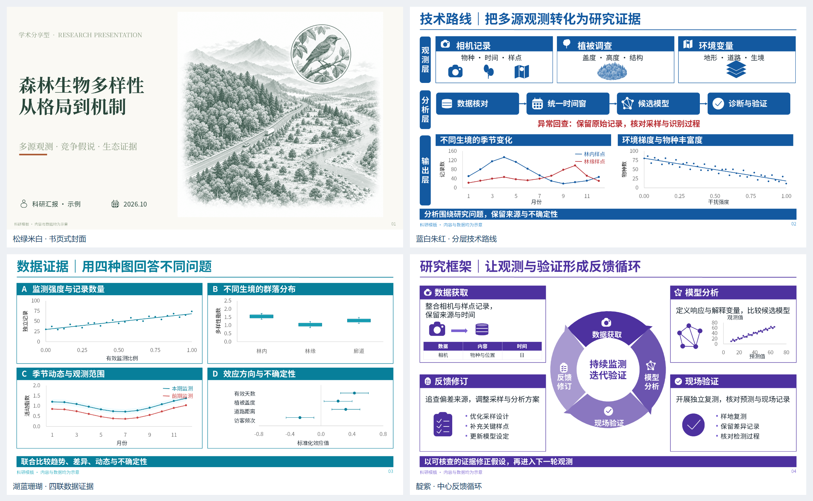

# 可编辑科研 PPT · 便携开源版 v1.1.1

三种汇报场景、六套配色、两种填充风格、十四种原生版式。把已确认的设计保存在 PPTX 模板中，再填入内容与数据，减少换电脑或换模型时的重新排版。



[下载四页可编辑宣传样板](examples/promo/showcase.pptx) · [查看四页预览](examples/promo/README.md) · [学术分享样板](examples/stable-academic.pptx)

**代码与文档采用 MIT；随包字体遵循各自 OFL-1.1 许可证。** 本目录作为 ScholarFlow 的可编辑科研汇报扩展提供，也可以单独复制为 Agent Skill。它不依赖四个文献技能的 shared 引擎，不负责核实科研结论。

## v1.1 新增

**厚实实底版**：六套配色均可使用；深色实底白字栏目、实填关键节点、实体图标、白色绘图区。同步提高主色与辅助色的色彩纯度，减少灰蒙感。原轻盈浅底版与旧样板保留。

- [9页厚实版样板](examples/solid-showcase.pptx)：前6页同版式比较六色，后3页展示数据证据、循环框图和进展矩阵。
- [4页浅底/实底对照](examples/fill-comparison.pptx) · [14种厚实版式](examples/solid-all-layouts.pptx)
- [新增样板预览](examples/index.html#solid-showcase)

## 先看效果

- 打开 [样板总览](examples/index.html)：79 页实际 PowerPoint 渲染，包含三套场景样板、六配色对比及十四版式全集。
- [学术分享 8 页](examples/academic.pptx) · [课程作业 6 页](examples/coursework.pptx) · [实验进展 6 页](examples/progress.pptx)
- [六配色图表 6 页](examples/palettes.pptx) · [十四版式全集](examples/all-layouts.pptx)
- 所有样板都是**合成示意数据**，不能作为研究证据。真实汇报请替换为有来源的数据与内容。

## 三分钟开始

需要 Python 3.10 或更新版本。生成部分只使用 Python 标准库，无需 pip、Node、API 密钥或私有运行时。在解压后的本目录运行：

```console
python scripts/check_environment.py
python scripts/install_fonts.py
python scripts/generate.py --input assets/examples/stable-academic.json --output my-talk.pptx
python scripts/audit.py my-talk.pptx
```

字体安装脚本仅向**当前用户**字体目录写入随包 Noto 字体；不覆盖不同版本的同名文件。安装后重启 PowerPoint/WPS。若不想运行脚本，也可以手动安装 `fonts/` 中四个 OTF 文件。字体随包提供，未嵌入每份 PPTX；查看 PPT 的另一台电脑也需安装。

Windows 上如 `python` 指向商店占位程序，可使用已安装的 `py -3`。macOS/Linux 通常使用 `python3`。生成不要求 Office；打开、预览和人工编辑需要相应演示软件。

脚本默认拒绝覆盖已有输出，确定需要替换时显式加 `--force`。`--font-profile office` 可改用微软雅黑/宋体，但不会提供或安装这些商业字体，也不保证其他系统存在。

## 作为 Agent Skill 使用

把**整个目录**放进所用助手的技能目录，保留 `SKILL.md`、`scripts/`、`assets/`、`references/` 和 `fonts/` 的相对关系。例如支持该目录约定的 Codex 环境可使用 `~/.codex/skills/editable-research-ppt/`；其他助手以其技能发现机制为准。若已经装有同名旧版，先保留旧版备份，勿直接覆盖。此模块可单独安装；现有文献技能的 Python 3.9 要求与本模块的 Python 3.10+ 要求相互独立。

告诉助手：

> 用 editable-research-ppt 做科研汇报。先问我的场景，再问主配色，最后问填充风格；内容用我提供的材料，保留可编辑文字、框图和数据图。

技能会先确认**学术分享 / 课程作业 / 实验进展**，再确认配色，再确认**轻盈浅底 / 厚实实底**，然后梳理内容、选版式、填数据、生成、预览及修改。已给出的选择不重复询问。无需重新生成风格图；新增风格时才先做视觉候选。

也可不使用 AI：直接编辑示例 JSON，运行脚本，或在 PowerPoint 中修改 `assets/templates/library.pptx` 的副本。

新增输入字段示例：`"fill_style": "solid"`（厚实）或 `"light"`（浅底）。未填字段的旧输入保持浅底版，不改变已有输出。新建汇报必须先询问使用者。

## 可选范围

| 场景 | 内容侧重 |
| --- | --- |
| 学术分享 | 研究问题、竞争解释、证据与边界、讨论 |
| 课程作业 | 任务要求、概念与方法、比较推导、回答与反思 |
| 实验进展 | 本期目标、完成状态、初步结果、问题与下一步 |

下表为厚实版主色；浅底版保留 v1.0 色值，完整参数见 `assets/template-system.json`。

| 配色 | 主色 | 配色 | 主色 |
| --- | --- | --- | --- |
| P1 蓝白朱红 | `#1359A0` | P4 酒红灰蓝 | `#8F2445` |
| P2 松绿米白 | `#136742` | P5 靛紫芥黄 | `#4D319F` |
| P3 石墨青金 | `#07556B` | P6 湖蓝珊瑚 | `#087F9A` |

十四版式包括循环机制、分层技术路线、对照证据、进展矩阵、封面、目录、章节过渡、三栏架构、双机制比较、中心模型、四联数据图、六维问题、研究展望和结束页。

## 可编辑与复现边界

- 文字、表格、几何框图和标准数据图是原生对象；山林、鸟类等精细插画是可替换位图，不能逐笔编辑。没有把整页图片冒充可编辑 PPT。
- 图表随 PPT 内嵌 XLSX 数据。区间图采用原生组合图；箱线图采用堆积柱与误差线，须线为最小值/最大值，并非 Tukey 1.5 IQR。效应图的误差线来自输入上下限。详见 [数据与模板约定](references/input-and-templates.md)。
- 模板容量固定：可以换文字、数据、配色，复制、删除、重排版式；不支持任意增加节点、图表系列或表格行列。超容量请拆页，或维护新模板。部分图标和章节导航高亮固定，限制会显式报错。
- 脚本保留几何布局，但不同 Office/WPS 版本、系统字体渲染、模型写作能力会影响结果。**不能承诺其他电脑与本机像素完全一致。** 数据文件相同且环境相同时，生成内容应一致；跨平台 ZIP 压缩字节可能受 Python/zlib 版本影响。
- 已实测范围与结果见 [验证记录](references/validation.md)；未测试平台不标成已兼容。原始生成图的个别细节曾作原生化简化，本包不宣称严格逐像素复刻。

## 开发与来源

```console
python -I -S tests/test_portable.py
```

11项测试覆盖全部示例、六色×十四版式的实底输出及数据/文字不变、三场景实底运行、旧版输出字节兼容、重排复制、数据更新、拒绝越界数据、误差线、复制目录及保护已有输出。可用环境变量 `PPT_TEST_TMP` 指定临时目录。CI 配置提供 Windows/Linux/macOS 测试矩阵；本地存在配置不代表远程 CI 已执行。

模板本身就是可编辑设计源文件，字段绑定在 `assets/templates/bindings.json`。修改规则见 [模板维护](references/input-and-templates.md#维护模板)。无需获得原制作环境才能维护。

素材、字体来源和许可边界见 [THIRD_PARTY_NOTICES.md](THIRD_PARTY_NOTICES.md)。这份包不包含商业字体、他人的完整 PPT、个人实验数据、账号密钥或原制作工具的私有运行时。

English: editable research presentation templates, MIT code, bundled OFL fonts, Python standard library generation. Includes 3 scenarios, 6 palettes and 14 layouts. Rendering is application-dependent; all demo data are synthetic. Run the commands above from this directory.

## 已批准标准与跨场景样板（v1.1.1）

2026-10-19 用户确认厚实大字版；标题/正文/图表字号与32px左右边距固定，换内容不自动缩字。保留先场景、再配色、再填充风格的选择。

- [学术分享 · 松绿米白 · 4页](examples/stable-academic.pptx)：城市鸟类与绿地连通性。
- [课程作业 · 靛紫芥黄 · 4页](examples/stable-coursework.pptx)：群落多样性指标比较。
- [实验进展 · 湖蓝珊瑚 · 4页](examples/stable-progress.pptx)：相机监测与记录复核。

新增12页、19个原生图表；所有页的原生形状位置/大小与字号对照已批准样板一致，PowerPoint实际渲染及编辑保存重开通过，文字高度溢出提示为0。有限容量的模板仍需逐页检查，新内容过长时先改写或拆页。详见 [跨场景验证](references/validation-scenarios.json)。
