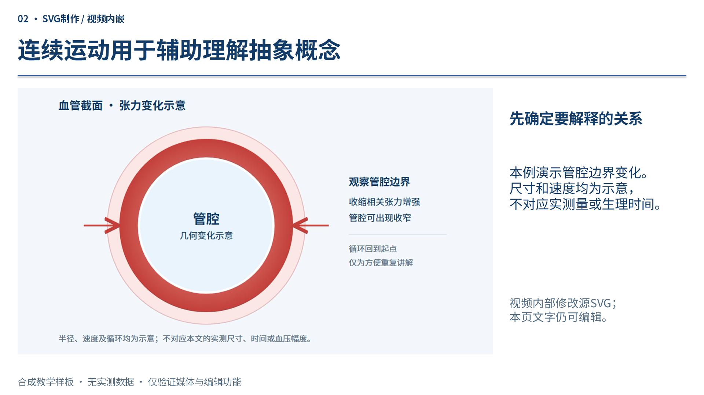

# 媒体与解释性动画样板



[离线互动预览](preview.html) · [三页可编辑PPT](demo.pptx)

这是合成教学示例，不含私人论文、研究数据或第三方插图。自绘SVG、视频与文档随本包采用MIT；PPT字体仍依随包字体许可。

- `demo.pptx`：3页，点击分步呈现、同源SVG视频内嵌、静态后备。第1页有3次点击淡入；第2页自动循环播放；第3页无动画。
- `base.pptx`：后处理之前的可编辑底稿；`effects.json`：按形状名称选择点击步骤，并指定MP4放置区域。
- `concept.svg`：浏览器可播放的连续动画源文件；`concept.mp4`：同源渲染结果；`static.png`：静态关键帧。SVG不能作为网页动画直接在普通PPT图片对象中运行。
- `media-manifest.json`：源文件、后备与视频哈希及编辑边界。

Windows安装桌面PowerPoint后，从技能根目录重建（输出文件必须尚不存在）：

```powershell
powershell -NoProfile -ExecutionPolicy Bypass -File scripts/add_media.ps1 -Source examples/media/base.pptx -Config examples/media/effects.json -Output my-media-demo.pptx
python scripts/audit_media.py --manifest examples/media/media-manifest.json --pptx my-media-demo.pptx
```

演示视频是预渲染资源，重建PPT不需要联网或浏览器；修改SVG运动后需重新渲染视频，再更新清单中相应哈希。素材核验不能替代实际放映。本样板未验证WPS、macOS PowerPoint或网页版Office。
