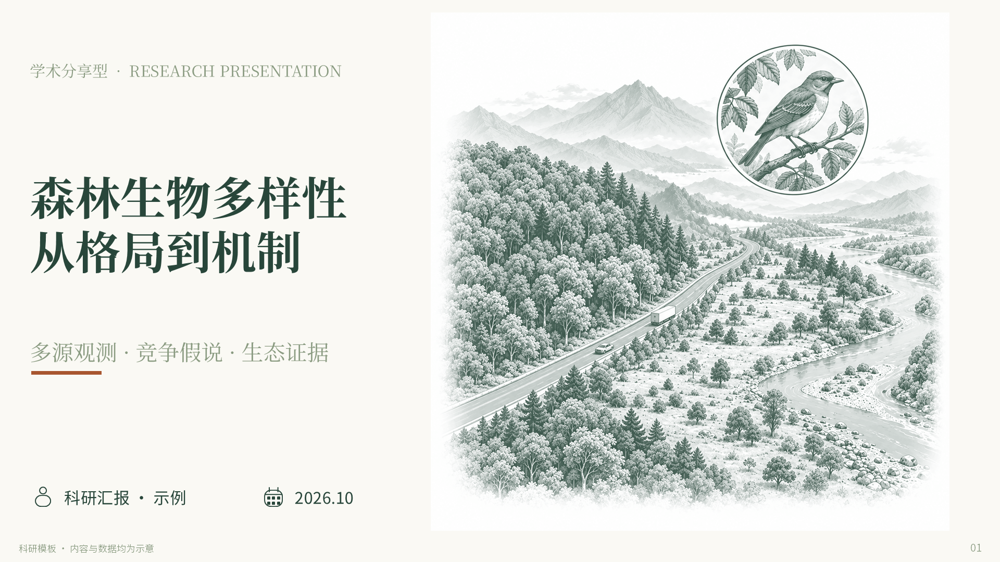
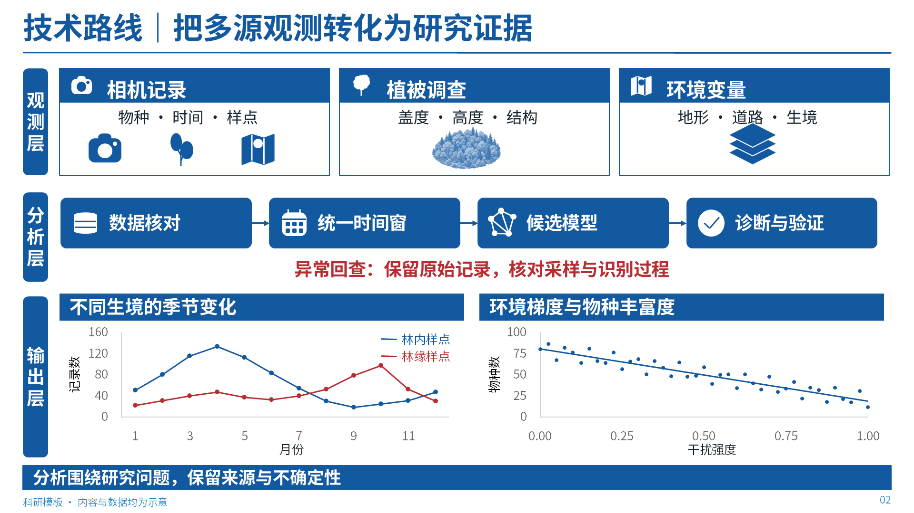
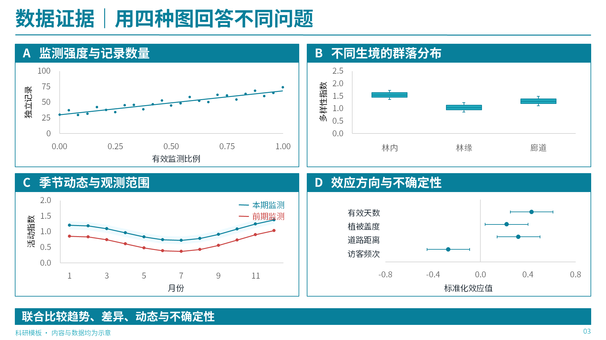
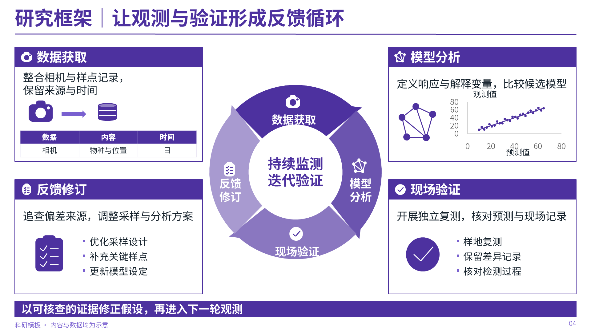

# 四页真实 PowerPoint 样板

[下载可编辑 PPTX](showcase.pptx) · [输入 JSON](../../assets/examples/promo-showcase.json)

以下图片均由实际 PPT 导出，非整页生图。4种配色与排版，77个原生文本对象、7个原生数据图、1个表格。框图使用原生形状；2个精细生态插画对象为独立可替换图片。所有数据为合成示意。

## 松绿米白 · 插画封面

## 蓝白朱红 · 分层技术路线

## 湖蓝珊瑚 · 四联数据图

## 靛紫 · 研究反馈循环

区间误差线不随工作簿自动联动；箱线图原始观测在输入JSON中。详见[编辑边界](../../references/input-and-templates.md)。
